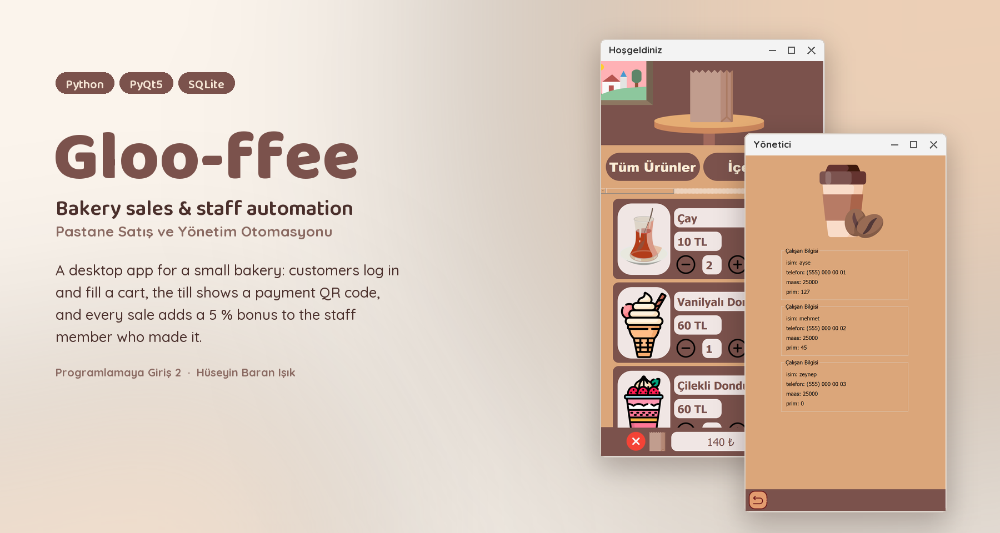
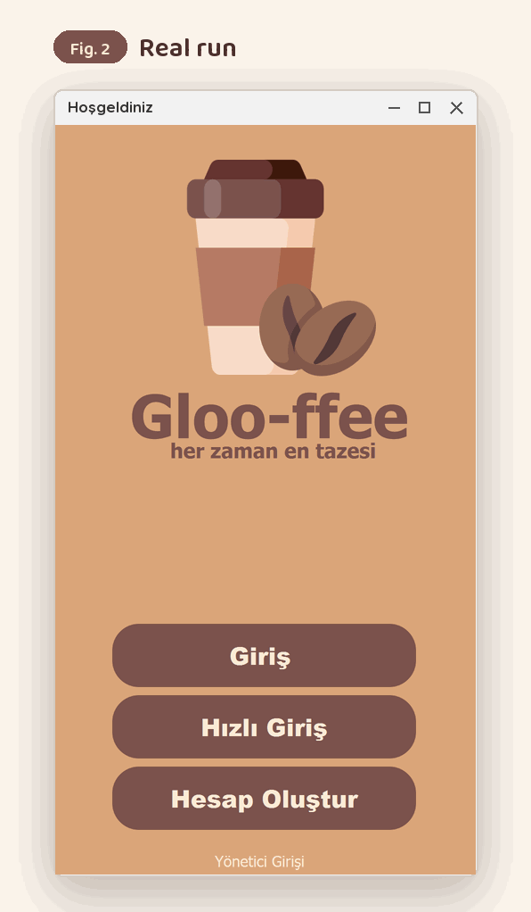
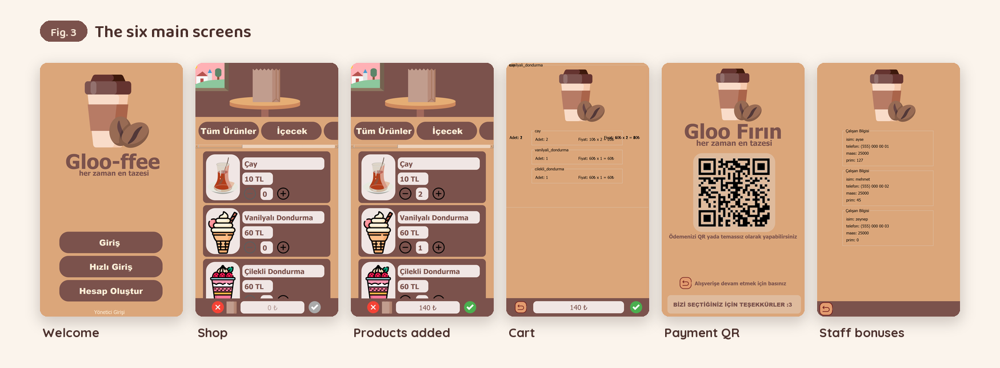
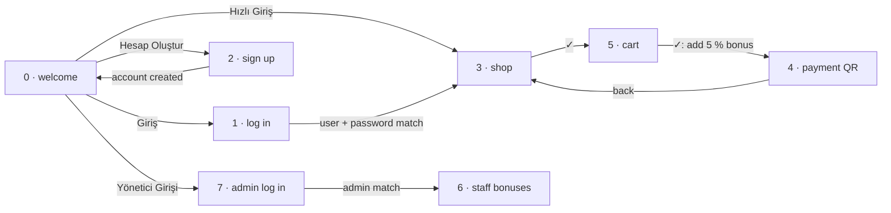
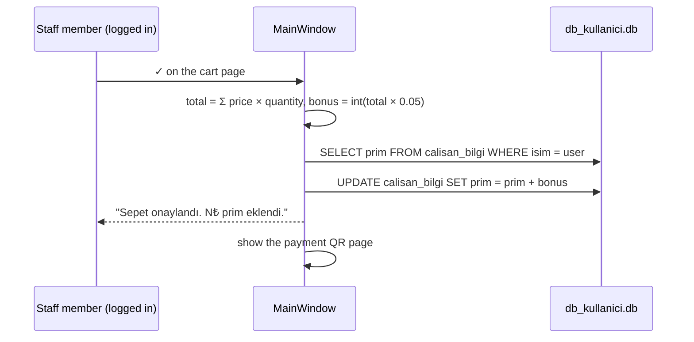
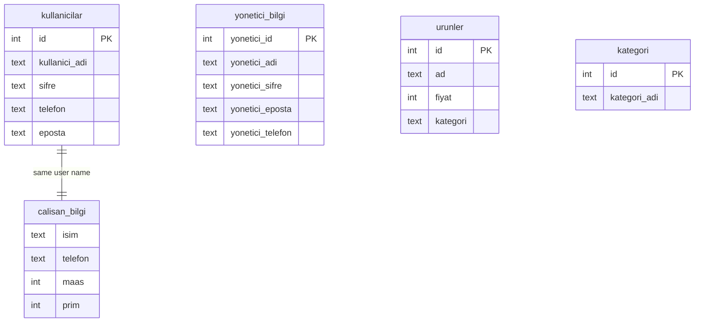

<p align="center">
  
</p>

<p align="center">
  <a href="#demo">Demo</a> &nbsp;·&nbsp;
  <a href="#what-it-does">What it does</a> &nbsp;·&nbsp;
  <a href="#how-it-works">How it works</a> &nbsp;·&nbsp;
  <a href="#run-it">Run it</a> &nbsp;·&nbsp;
  <a href="#known-limits">Limits</a> &nbsp;·&nbsp;
  <a href="#türkçe">Türkçe</a>
</p>

**Gloo-ffee** (*Pastane Satış ve Yönetim Otomasyonu*) is a desktop app for a small bakery-café, written in Python
with PyQt5 and SQLite. Users log in and fill a cart from 18 products, the till shows a payment QR code, and every
confirmed sale adds a 5 % bonus to the staff member who made it. An admin screen lists the staff with their
salaries and bonuses. It was made for the **Programlamaya Giriş 2** (Introduction to Programming 2) course.

<br>

## Demo

<p align="center">
  
</p>

This is the real app (`pastahane_uygulaması/main.py`), driven by [`tools/capture_app.py`](tools/capture_app.py)
with the demo accounts: it logs in as `ayse`, adds 140 ₺ of products, confirms the cart (the app reports
"7₺ prim eklendi", 5 % of 140) and then opens the admin's staff table, where ayse's bonus has gone from 120 to 127.
The app is drawn without opening a window, so message boxes do not appear in the GIF.

<p align="center">
  
</p>

<br>

## What it does

<table>
<tr><td width="24%"><b>Accounts</b></td><td>Sign up with user name, email, phone and password (twice). The email is checked with a regular expression. Each new account is also added to the staff table with a 25 000 ₺ salary and a 0 bonus. Password fields have a show/hide button.</td></tr>
<tr><td><b>Shop</b></td><td>18 products in 7 categories (all, drinks, desserts, savoury, cookies, breakfast, ice cream). Each card has + and − buttons; the running total is shown at the bottom. ✗ empties the cart.</td></tr>
<tr><td><b>Cart and payment</b></td><td>The cart lists each product with quantity and line total. ✓ confirms the sale and opens the payment page with a QR code ("Gloo Fırın").</td></tr>
<tr><td><b>Staff bonus</b></td><td>Confirming a cart adds <code>int(total × 0.05)</code> to the bonus of the logged-in user in <code>calisan_bilgi</code>.</td></tr>
<tr><td><b>Admin</b></td><td>"Yönetici Girişi" opens an admin login; after it, every staff member is listed with name, phone, salary and bonus.</td></tr>
<tr><td><b>Quick entry</b></td><td>"Hızlı Giriş" goes straight to the shop without logging in.</td></tr>
</table>

### Products

| Category | Products (price in ₺) |
| :--- | :--- |
| İçecek (drinks) | Çay 10 · Kahve 120 · Bubble tea 150 |
| Kahvaltılık (breakfast) | Çay 10 · Simit 15 · Kruvasan 25 · Peynirli / karışık tost 30 · Peynirli / karışık sandviç 55 |
| Tuzlu (savoury) | Simit 15 · Tostlar 30 · Sandviçler 55 · Tuzlu kurabiye 10 |
| Kurabiye (cookies) | Çikolatalı / çilekli / tuzlu kurabiye 10 |
| Tatlı (desserts) | Makaron 20 · Donut 70 · Cupcake 70 · Çilekli kurabiye 10 · Dondurmalar 60 |
| Dondurma (ice cream) | Çikolatalı / çilekli / vanilyalı dondurma 60 |

Prices from `urun_fiyatlari` in `main.py`; some products appear in more than one category.

<br>

## How it works

The window is a `QStackedWidget` with eight pages, designed in Qt Designer (`ui_proje.ui`) and compiled to
`py_proje_v5.py` by `uitopy.py`. All behaviour is in `main.py` (`MainWindow`), and all data is in one SQLite file,
`db_kullanici.db`.



What happens when a cart is confirmed:



The database:



<br>

## Run it

Python 3 with PyQt5.

```bash
git clone https://github.com/huseyinbaranisik/online_cafe_order_app.git
cd online_cafe_order_app/pastahane_uygulaması
pip install PyQt5
python main.py
```

Run it from inside `pastahane_uygulaması/`: the app opens `db_kullanici.db` and the icons by relative path.
After editing `ui_proje.ui` in Qt Designer, run `python uitopy.py` to regenerate `py_proje_v5.py`.

> [!NOTE]
> The database in this repository holds **demo data only**: users `ayse`, `mehmet` and `zeynep` (password
> `demo123`) and the admin `yonetici` (password `admin123`). The products and categories are the original ones.

<br>

## Known limits

- **Passwords are stored in plain text** in `kullanicilar` and `yonetici_bilgi`. Fine for a course project, not
  for real use.
- **"Hızlı Giriş" has no active user**, so confirming a cart after quick entry shows "Aktif kullanıcı bulunamadı!"
  and no bonus is added.
- **The active user is set even when login fails** (`giris_yap` assigns it after the check), so a failed attempt
  followed by quick entry would credit the bonus to the name that was typed.
- **Admins are added by hand.** There is no screen to create an admin; `yonetici_bilgi` was filled directly.
- **The cart page draws some labels on top of each other** at the top left, as in Fig. 3.
- **The QR code is not a real payment.** Earlier versions of this README promised "a little surprise" when it is
  scanned.

<br>

## Credits

- Course project for **Programlamaya Giriş 2** by Hüseyin Baran Işık. `BENİ OKU.txt` says the code and documents
  may be used, changed and shared without restriction.
- Product icons are in `pastahane_uygulaması/icon/`; several file names follow Flaticon's numbering, and
  `Coffee Shop Mobile UI Kit for App Design.jpeg` looks like a design reference. Their sources and licences are
  not stated in the repository.
- README figures set in Baloo 2 and Quicksand, both under the SIL Open Font License ([`tools/fonts/`](tools/fonts/)),
  in colours sampled from the app. Rendered by [`tools/render_figures.py`](tools/render_figures.py).

<br>

---

## Türkçe

**Gloo-ffee** (*Pastane Satış ve Yönetim Otomasyonu*), küçük bir pastane-kafe için Python, PyQt5 ve SQLite ile
yazılmış bir masaüstü uygulamasıdır. Kullanıcılar giriş yapıp 18 üründen sepet doldurur, kasa bir ödeme QR kodu
gösterir ve onaylanan her satış, satışı yapan çalışana %5 prim ekler. Yönetici ekranı çalışanları maaş ve
primleriyle listeler. **Programlamaya Giriş 2** dersi için hazırlanmıştır.

### Demo

Yukarıdaki GIF (Şekil 2), gerçek uygulamanın (`pastahane_uygulaması/main.py`) demo hesaplarıyla
[`tools/capture_app.py`](tools/capture_app.py) tarafından kullanılmasıdır: `ayse` olarak giriş yapar, 140 ₺'lik ürün
ekler, sepeti onaylar (uygulama "7₺ prim eklendi" der, 140'ın %5'i) ve sonra yöneticinin çalışan tablosunu açar;
ayse'nin primi 120'den 127'ye çıkmıştır. Uygulama pencere açmadan çizildiği için mesaj kutuları GIF'te görünmez.
Şekil 3 altı ana ekranı gösterir.

### Ne yapıyor

<table>
<tr><td width="24%"><b>Hesaplar</b></td><td>Kullanıcı adı, e-posta, telefon ve iki kez şifreyle kayıt olunur. E-posta düzenli ifadeyle (regex) kontrol edilir. Her yeni hesap, 25 000 ₺ maaş ve 0 primle çalışan tablosuna da eklenir. Şifre alanlarında göster/gizle butonu var.</td></tr>
<tr><td><b>Market</b></td><td>7 kategoride 18 ürün (tümü, içecek, tatlı, tuzlu, kurabiye, kahvaltılık, dondurma). Her kartta + ve − butonu var; anlık toplam altta görünür. ✗ sepeti boşaltır.</td></tr>
<tr><td><b>Sepet ve ödeme</b></td><td>Sepet her ürünü adet ve satır toplamıyla listeler. ✓ satışı onaylar ve QR kodlu ödeme sayfasını ("Gloo Fırın") açar.</td></tr>
<tr><td><b>Çalışan primi</b></td><td>Sepeti onaylamak, giriş yapmış kullanıcının <code>calisan_bilgi</code> tablosundaki primine <code>int(toplam × 0.05)</code> ekler.</td></tr>
<tr><td><b>Yönetici</b></td><td>"Yönetici Girişi" bir yönetici girişi açar; ardından her çalışan adı, telefonu, maaşı ve primiyle listelenir.</td></tr>
<tr><td><b>Hızlı giriş</b></td><td>"Hızlı Giriş" giriş yapmadan doğrudan markete gider.</td></tr>
</table>

Ürünler ve fiyatlar yukarıdaki tabloda (`main.py` içindeki `urun_fiyatlari`); bazı ürünler birden fazla kategoride.

### Nasıl çalışıyor

Pencere, Qt Designer'da tasarlanmış (`ui_proje.ui`) ve `uitopy.py` ile `py_proje_v5.py`'ye derlenmiş sekiz sayfalı bir
`QStackedWidget`'tır. Bütün davranış `main.py`'de (`MainWindow`), bütün veri tek bir SQLite dosyasında
(`db_kullanici.db`). Sayfalar arası geçiş, sepet onayında olanlar ve veritabanı yapısı yukarıdaki üç Mermaid
diyagramında gösteriliyor.

### Çalıştırma

Python 3 ve PyQt5.

```bash
git clone https://github.com/huseyinbaranisik/online_cafe_order_app.git
cd online_cafe_order_app/pastahane_uygulaması
pip install PyQt5
python main.py
```

Uygulamayı `pastahane_uygulaması/` klasörünün içinden çalıştır: `db_kullanici.db` ve ikonlar göreli yolla açılıyor.
`ui_proje.ui` Qt Designer'da değiştirildikten sonra `python uitopy.py` ile `py_proje_v5.py` yeniden üretilir.

> [!NOTE]
> Bu repodaki veritabanında **yalnızca demo veri** var: `ayse`, `mehmet` ve `zeynep` kullanıcıları (şifre
> `demo123`) ve `yonetici` yöneticisi (şifre `admin123`). Ürünler ve kategoriler orijinal.

### Bilinen kısıtlar

- **Şifreler düz metin olarak saklanıyor** (`kullanicilar` ve `yonetici_bilgi`). Ders projesi için sorun değil,
  gerçek kullanım için uygun değil.
- **"Hızlı Giriş"te aktif kullanıcı yok**; hızlı girişten sonra sepet onaylanırsa "Aktif kullanıcı bulunamadı!"
  uyarısı çıkar ve prim eklenmez.
- **Giriş başarısız olsa bile aktif kullanıcı atanıyor** (`giris_yap` bunu kontrolden sonra yapıyor); başarısız
  bir denemenin ardından hızlı giriş yapılırsa prim yazılan isme eklenir.
- **Yöneticiler elle ekleniyor.** Yönetici oluşturacak bir ekran yok; `yonetici_bilgi` doğrudan doldurulmuş.
- **Sepet sayfası sol üstte bazı yazıları üst üste çiziyor** (Şekil 3'teki gibi).
- **QR kod gerçek bir ödeme değil.** README'nin önceki sürümü, okutulunca "küçük bir sürpriz" olduğunu söylüyordu.

### Teşekkür

- **Programlamaya Giriş 2** dersi projesi, Hüseyin Baran Işık. `BENİ OKU.txt`'ye göre kodlar ve dokümanlar hiçbir
  kısıtlama olmadan kullanılabilir, değiştirilebilir ve paylaşılabilir.
- Ürün ikonları `pastahane_uygulaması/icon/` klasöründe; bazı dosya adları Flaticon'un numaralandırmasına benziyor,
  `Coffee Shop Mobile UI Kit for App Design.jpeg` ise bir tasarım referansına benziyor. Kaynakları ve lisansları
  repoda belirtilmemiş.
- README figürlerinde Baloo 2 ve Quicksand kullanıldı; ikisi de SIL Open Font License altındadır
  ([`tools/fonts/`](tools/fonts/)). Renkler uygulamadan örneklendi.
